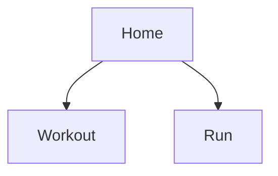
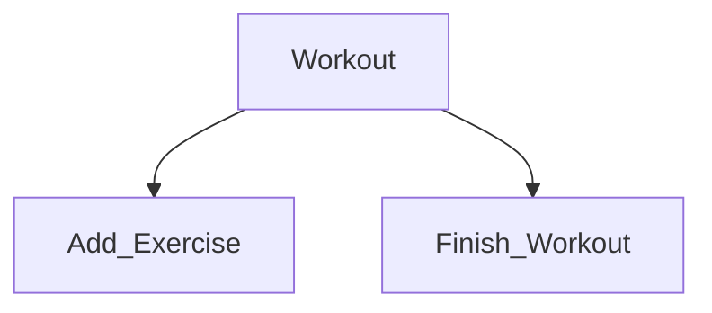
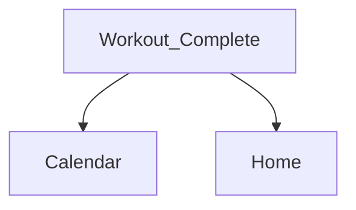
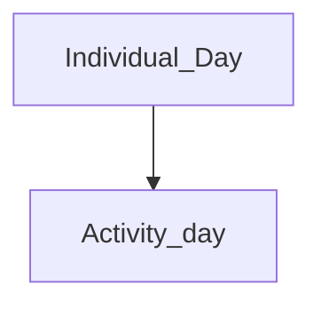
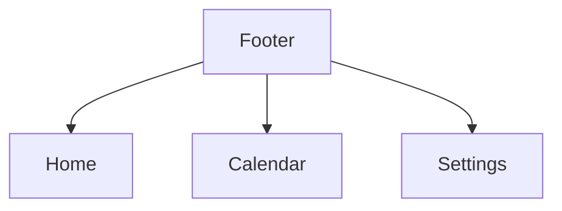

# StrideSet Report II

## 1. User journeys, app flow, and navigation structure

### User Journeys

#### User journey 1 – Creating a workout plan

**User:** Regular Gym User

**Goal:** Create and save a personalized gym workout plan for future training sessions.

**Motivation:** The user wants to organize their gym exercises in advance.

**Journey steps:**

1. The user opens the StrideSet application.
2. The user selects the option to “Create Workout Plan”.
3. The user selects exercises to include.
4. If an exercise is unavailable, the user can create a custom exercise.
5. The user organizes the exercises according to their preferences.
6. The user saves the plan with a name.
7. The saved workout becomes available for future workout sessions.

**Expected outcome:** The user successfully creates a personalized workout plan that can be reused during future training sessions.

**User experience goal:** The process should be simple, quick, and customizable without unnecessary steps.

#### User journey 2 - Logging a gym workout

**User:** Regular Gym User

**Goal:** Record a completed gym workout, including exercises, sets, repetitions, and weights.

**Motivation:** The user wants to replace manual workout notes with a more organized way of recording training performance.

**Journey steps:**

1. The user opens the StrideSet application.
2. The user navigates to the gym workout section.
3. The user selects an existing workout plan or starts an empty workout manually.
4. The user begins recording their workout.
5. The user enters the number of sets, repetitions, and weights performed for each exercise.
6. After completing the workout, the user selects the option to finish the session and confirms the action.
7. The application stores the recorded workout information.
8. The user can access the completed workout through their training history calendar.

**Expected outcome:** The workout is successfully saved, and the user can review the recorded exercises and performance later.

**User experience goal:** Workout logging should be fast, straightforward, and flexible enough to accommodate different training routines.

#### User Journey 3 – Viewing Progressive Overload Recommendations

**User:** Regular Gym User

**Goal:** View recommendations for improving future gym workout performance.

**Motivation:** The user wants to understand whether they should increase their training weights or repetitions based on previous workout results.

**Journey steps:**

1. The user opens StrideSet.
2. The user navigates to their gym workouts.
3. The user selects an exercise with previously recorded performance data.
4. The application uses previous workout results to calculate a progression recommendation.
5. The user views the suggested increase in weight or repetitions.
6. The user considers the recommendation when performing their next workout.
7. The user can follow the suggestion or manually enter different values based on their preference.

**Expected outcome:** The user receives a simple recommendation based on previous performance while retaining control over their workout.

**User experience goal:** Recommendations should be easy to understand and should support progression without forcing the user to follow them.

#### User Journey 4 – Tracking a Running Session

**User:** Mixed Training User

**Goal:** Track and save a running activity using the application.

**Motivation:** The user wants to track running activities using the same application they use for gym workouts.

**Journey steps:**

1. The user opens StrideSet.
2. The user selects the option to start a running session.
3. The application requests location permission if necessary and displays the GPS status.
4. The application uses the configured location tracking functionality or external running API.
5. The user begins running while the application tracks the activity.
6. After finishing the run, the user stops the tracking session.
7. The application saves running activity.
8. The user can access the recorded run in their activity history.

**Expected outcome:** The user successfully records and saves a running session without needing a separate running application.

**User experience goal:** Starting and completing a running activity should require minimal interaction and have a clear, understandable interface.

### App Flows Diagram

### Main app flows

StrideSet uses a simple bottom navigation bar with three main sections: Home, Calendar and Settings.

**Home:** The main entry point of the application, where users can start a gym workout or a running session. When users start a gym workout, they are taken to a separate screen for building or selecting a workout plan. After starting a workout plan, they are taken to an activity screen. Alternatively if users choose to start a run from the home screen, they are taken straight to a running activity page. After finishing an activity, they see a completion screen with their recorded results and can navigate to the Calendar or return to Home using the Done button.

**Calendar:** Allows users to view their previously completed gym workouts and running activities, with days containing recorded activities clearly marked on the calendar.

**Settings:** Allows users to change their preferred measurement units for distance (km/miles) and weight (kg/lb).

### Screen and Navigation Implementation

#### Navigation Graphs

##### Home 'Start' Screen:

##### Workout Screen:

##### Workout Complete Screen:

##### Calendar Screen:

##### Footer or The Bottom Menu:

## 2. Wireframes and coverage of key system states

### Wireframes

The first wireframe was created to define the basic structure, navigation, and main user flows of StrideSet before applying the final visual design. At this stage, the focus was on functionality rather than colors, typography, or detailed styling. The wireframe included the main Home, Calendar, and Settings screens, together with the core workout flows for starting and completing both running and gym workouts. It also established the bottom navigation structure and showed how users would move between active workout states and completed workout summaries. This wireframe later served as the foundation for the higher-fidelity design, where the visual system was applied and additional screens and states were introduced.

During later iterations, the wireframe was expanded and refined. Additional screens and interface states were added where the original flow was too simplified, and the visual design system was applied on top of the existing structure. The overall navigation and core workout flows remained largely consistent, while individual screens were improved to make actions, information hierarchy, and workout feedback clearer.

### Edge cases and system states

The prototype shows success states (the "Workout complete" and "Run complete" screens) but no empty, loading, error or validation states yet.

| ID | Flow / Screen | Situation | Expected behavior |
| --- | --- | --- | --- |
| E1 | Home, Calendar | No workouts or runs saved yet, or the selected day has no activities. | Show a message ("No activities yet" / "No activities on this day") with a button to start a workout. |
| E2 | Workout | The user finishes a workout with no exercises or no completed sets. | Ask "Discard empty workout?". An empty workout is not saved. |
| E3 | Set logging | Weight or reps is empty, zero, negative or not a number. | Numeric keyboard only. Show an error message and do not save the set. |
| E4 | Custom exercise | The exercise name is empty or already exists. | Show an error message next to the field. The exercise is not saved. |
| E5 | Progressive overload | The exercise has no previous data, or the last session was not completed. | No data: show "Log this exercise once to get a suggestion". Not completed: do not increase the weight. The user can always change it. |
| E6 | Run | Location permission is denied. | Explain why location is needed and offer a button to open settings. |
| E7 | Run | GPS signal is weak or still searching when the run starts. | Show "Searching for GPS...". Distance starts counting once a signal is found. |
| E8 | Workout, Run | The app is closed, the phone is locked or a call comes in during a session. | The session keeps running and the timer is correct when the user returns. |
| E9 | Calendar, Saving | Data is loading, or saving a workout or run fails. | Show a short loading indicator. On failure show an error message with Retry. Data is never silently lost. |
| E10 | Settings | Units are changed after data already exists. | All existing workouts and runs are shown in the new unit, correctly converted. |

### Definining Data and System States

#### Home

| State | Trigger | Behaviour |
| --- | --- | --- |
| Default | No unfinished workout or run exists | Title, "Start Workout" and "Start Button", Bottom Footer for Navigation are all displayed |
| Activity in progress | App reopened while a workout or run is in progress | Either bring the user back to the workout or run screen directly or replace the Start Workout / Run button with a temporary "Resume" button |
| Error | N/A, possible causes need to be determined during development | Home displays no Data or an error message is shown |

#### Workout

| State | Trigger | Behaviour |
| --- | --- | --- |
| Leave attempt | Back pressed on Android while in Workout mode | Dialog Window popup: Finish Workout / Discard / Continue (To clear the popup, possibly a missclick by the user) |
| Discard Workout Confirmation | Discard button pressed | A confirmation dialogue window pops up. Workout should be discarded / deleted after confirmation |
| Validation failure: empty workout | Finish Workout button pressed with no exercises or completed sets | Finish Workout button blocked along with a proper message |
| Validation failure: missing info regarding the exercise | A weight is assigned but no reps are written down | Display a proper warning |
| Default | One or more plans saved | Start empty workout button, Create Plan button, a list of saved plans along with an edit button are all displayed |
| Loading | Fetching plans from the database | Local data loads pretty much instantly |
| Error | Fetching the plans fails | Display an error for the plans specifically, but keep the Start Empty Workot usable |
| Navigate Back | Button pressed or the Android global back button is pressed | Return to Home screen |

##### Validation rules

| Field | Rule(s) | Error message | When checked (typing / leaving field / saving) |
| --- | --- | --- | --- |
| Sets | No negative numbers or 0, no impossibly large numbers like 9999 | "Please enter a valid number of sets" | Leaving the field |
| Weight | No negative numbers or again very large numbers. 0 here is fine since maybe the excercise is done with just the base weight, for example just the bar or using bodyweight | "Please enter a valid weight" | Leaving the field |

#### Run

| State | Trigger | Behaviour |
| --- | --- | --- |
| Permission needed | "Start run" pressed and location permission not granted | _(Potential handling)_ Explanation of why location is needed, then the system permission dialog |
| Permission denied | User denies location permission | _(Potential handling)_ Message that displays for example "cannot be tracked without location", with a guide perhaps on how to enable set permission |
| Searching for GPS | Permission granted, no GPS found yet | _(Potential handling)_ "Searching for GPS" shown |
| Tracking | GPS working through an external API | Elapsed time, distance and pace update live. Pause, End Run, Discard are displayed properly |
| Paused | Pause button pressed | _(Potential handling)_ Timer and distance frozen, Pause becomes "Resume" |
| Signal lost | No GPS updates for a set time while tracking | _(Potential handling)_ Timer continues, distance stops updating, "GPS signal lost" indicator is displayed |
| Leave attempt | Android System Back pressed | _(Potential handling)_ End run / Discard / Continue run button displayed on a pop up window, also clicking outside the window can close the popup, timer and distance are still tracking |
| Discard confirmation | Discard button pressed | Confirmation dialog; the run is deleted only after confirming |
| In background | Screen off or user leaves the app during tracking | _(Potential handling)_ Tracking continues. Persistent notification shows the run and returns to this screen when pressed |
| Success | End run button pressed | Run saved, Run complete screen gets displayed |
| Error | Saving fails | _(Potential handling)_ Message shown, run data is kept |

#### Calendar

| State | Trigger | Behaviour |
| --- | --- | --- |
| Default | Calendar tab opened | Current month, today selected, dots on days with activities, list of the selected day's activities |
| Day with activities | Day with saved activities selected | List of workouts and runs with summary (duration, exercises or distance) and › to details |
| Day without activities | Day with no saved activities selected | _(Potential handling)_ "No activities were performed on this day" |
| Empty | No activities saved at all | _(Potential handling)_ Calendar is shown without any dots |
| Month change | Arrow buttons pressed on the top right | Months cycle in correct order |
| Loading | Reading activities | Not shown since local data should load instantly |
| Error | Reading activities fails | _(Potential handling)_ A message displaying loading or fetching |

#### Settings

| State | Trigger | Behaviour |
| --- | --- | --- |
| Default | Settings tab was opened or selected in the footer | User preferences for units are selected and assigned |
| Unit changed | User selects another unit | _(Potential handling)_ Saved immediately; the new unit is used for workouts and runs |
| Error | Saving the preference fails | _(Potential handling)_ Selection reverts, a pop up comes up |
| Empty / Loading | N/A, possible causes need to be determined during development | Not shown: Default conversion are shown |

#### App-wide states

| State | Trigger | Behaviour |
| --- | --- | --- |
| First launch | No data saved | _(Potential handling)_ Home in default state; Choose workout and Calendar show their empty states; units default to km and kg |
| App closed mid-workout | App process ends while a workout is unfinished | _(Potential handling)_ Workout is kept in memory or in some sort of cache. After reopening the app, the workout can be resumed |
| App closed mid-run | App removed from recent apps or killed during a run | _(Potential handling)_ Tracking continues or the run is saved and and the app triggers an end |

## 3. Interactive prototype and task completion flow

### Interactive prototype

The interactive prototype was created in Figma to show how the main StrideSet screens and user flows work together before implementation. It allows users to move through the core parts of the app, including starting and completing workouts, tracking runs, viewing previous activity, and navigating between the main sections. The prototype helped us check whether the navigation and interactions felt clear and logical, and it served as the basis for refining the final UI before development.

Interactive prototype: https://lever-neo-28221754.figma.site

### Test scenarios

T1-T4 are the four main workflows from our Stage 1 success metrics.

| ID | Scenario | Steps | Expected result | Covers |
| --- | --- | --- | --- | --- |
| T1 | Create a workout plan | Create a plan "Push day" with Bench press (3 x 8). Create a custom exercise "Cable fly" and add it. Save. | The plan is saved and shown in the plan list. The custom exercise can be found in the exercise picker. | AC2, AC3 |
| T2 | Log a gym workout | Start a workout from "Push day". Log 3 sets of Bench press at 60 kg x 8. Edit one set. Finish and confirm. Restart the app. | The summary shows the correct sets and weight. The workout appears in the calendar on today's date and is unchanged after the restart. | AC1, AC6 |
| T3 | View the progressive overload suggestion | After T2, start "Push day" again and open Bench press. Change the suggested weight. | The previous result (3 x 8 at 60 kg) and a suggestion are shown. The changed value is the one saved. | AC4 |
| T4 | Start and complete a run | Home > Start run. Allow location. Walk or run for a few minutes. End the run and confirm. | Time, distance and pace update during the run. The summary shows the values and the run appears in the calendar. | AC5 |
| T5 | Find a past activity | Open Calendar. Select a marked day and tap an activity. Then select a day with no activities. | The correct activities are listed and the details open. The empty day shows a message. | AC6, E1 |
| T6 | Change units | Settings > select miles and lb. Open a past run and workout. Restart the app. | Values are shown in miles and lb, correctly converted. The setting is kept after the restart. | AC7, E10 |
| T7 | Invalid set input | During a workout, leave reps empty, then enter "-5" as weight, and try to save the set. | An error message is shown and the set is not saved. | AC1, E3 |
| T8 | Location permission denied | Start a run and deny location permission. | A message explains why location is needed and offers to open settings. | AC5, E6 |
| T9 | Interrupted session | Start a workout and log one set. Lock the phone or switch apps for 1 minute. Return to the app. | The workout is still in progress with the logged set, and the timer shows the correct time. | AC1, E8 |
| T10 | First time on an exercise | Open an exercise that has never been logged. | A "No previous data" message is shown instead of a suggestion. | AC4, E5 |
| T11 | Response time | Open a saved workout, add a set and save a custom exercise. Then end a run (uses the running API). Time each action. | Local actions respond within about 500 ms. The run API actions complete within about 2 seconds on a stable network. | AC8 |

## 4. Final UI, design system, responsiveness, and accessibility 

### Final UI screens

The final UI shown below incorporates the changes made following the usability review and evidence-based iteration described in Section 5.

The final UI screens were created by building on the original wireframes and then refining the flows based on the quality review. The overall structure stayed similar, but the final version added clearer visual hierarchy, consistent styling, improved navigation, and more complete workout and running interactions.

Several missing parts from the first wireframes were added. The workout flow was expanded so users can choose a saved workout, start an empty workout, create and edit workout plans, and log individual sets with weights and repetitions. These were important changes because the earlier version did not support plan creation or detailed set logging, which were identified as major usability issues.

The running flow was also improved with actions such as Pause and Discard, while the completed workout and run screens were made clearer. The Calendar and Settings screens were refined as well, including clearer activity indicators and interactive unit selection. These changes addressed issues found during the review while keeping the simple and minimal visual style that already worked well in the first design.

### Design system

The StrideSet design system was created to keep the interface consistent across all screens. It defines the main colors, typography, spacing, buttons, input fields, navigation elements, and reusable workout components. The design uses a restrained visual style with high contrast and limited decorative elements to support the application's goal of being simple and uncluttered. Reusable components were used throughout the prototype so that equivalent actions and information are presented consistently.

### Responsiveness

The layouts below show StrideSet at two portrait frame sizes: 360 x 800 (Small) and 402 x 874 (Medium). The screens look and work essentially the same at both sizes, with the same layout, content, and main actions.

### What works well

- The layout is clean and minimal, which matches our main design principle ("no unnecessary bloat").
- The Run screen shows time, distance and pace in large, readable numbers.
- Screens follow a consistent structure: title at the top, main action at the bottom.
- Completion screens confirm that data was saved ("Saved", "Easy run saved"), which gives clear feedback.
- In Settings, the selected option is shown with a filled dot, bold text and a background, not by color alone.

### Accessibility findings

| ID | Screen | Finding | Severity | Suggestion |
| --- | --- | --- | --- | --- |
| **A1** | Calendar | The month arrows (‹ ›) are very small. | Medium | Touch targets should be bigger. |
| **A2** | Calendar | Days with activities are marked only by a tiny dot next to the number, which is easy to miss. | Medium | Use a larger dot or a filled circle under the date. |
| **A3** | Bottom navigation | Navigation is text only, the active tab is shown with brackets and the tap areas are small. | Low | Use clearer indication, buttons or icons. |

## 5. Usability review, evidence-based iteration, and developer specifications

### Quality Check

I walked through each main flow as a first-time user (start and finish a workout, start and finish a run, view the calendar, change settings) and checked the screens against the core features from our Stage 1 plan and a usability/accessibility checklist (clarity, number of steps, navigation, consistency, feedback, error recovery, text size, contrast, touch targets, color use).

| Severity | Meaning |
| --- | --- |
| High | Blocks a core task or a core feature is missing. |
| Medium | Causes confusion or mistakes, or makes a flow untestable. |
| Low | Polish, does not stop the user from completing a task. |

#### Usability review summary

We carried out a short usability review of the clickable prototype with 3 participants who were not involved in the design. Participants described the layout as very clean and simplified, which supports our main design principle of a minimal app without unnecessary features. The main problems reported were that the bottom navigation bar is too small, that most buttons don’t work yet in the prototype, and that the calendar interface is small. These results match our own review findings: the small navigation and calendar elements (A1–A3) and the non-functional buttons (U1, U5). The findings have been passed to the Design Leads.

#### Usability findings

| ID | Screen | Finding | Severity | Suggestion |
| --- | --- | --- | --- | --- |
| **U1** | Workout | "+ Add exercise" does nothing, so exercises cannot be added to a workout. Blocks the core gym logging flow. | High | Open an exercise picker with search and a "Create custom exercise" option. |
| **U2** | Workout | No screen for entering weight and reps per set. Exercise rows only show "3 sets". | High | Tapping an exercise opens a set-logging view: weight, reps, mark set as done, previous result shown. |
| **U3** | Home / Workout | "Start workout" opens fixed exercises. There is no way to create, save or choose a workout plan. | High | Let the user pick a saved plan or start an empty workout. Add a simple plan editor screen. |
| **U4** | Whole app | The progressive-overload recommendation is not shown anywhere. It is a core feature and a Stage 1 success metric. | High | Show the suggestion in the set-logging view, e.g. "Last: 3 x 8 at 60 kg, try 62.5 kg", editable by the user. |
| **U5** | Settings | Unit options (km/miles, kg/lb) cannot be selected, so the settings flow cannot be tested. | Medium | Make the options interactive and show the selected state. |
| **U6** | Workout, Run | No way to pause, cancel or leave a workout or run without finishing it. | Medium | Add Pause to the Run screen and a "Discard" option with confirmation to both screens. |
| **U7** | Workout, Run | "Finish workout" and "End run" end the session immediately. One accidental tap ends it. | Medium | Add a confirmation dialog. |
| **U8** | Workout complete, Run complete | "Back" is ambiguous: it is unclear whether it returns to the finished session or to Home. | Low | Rename it to "Done" and return to Home. |

### Usability Review and Iteration

A usability and quality review was carried out on the initial prototype to identify problems in the main workflows. The most important findings were missing workout-plan creation, incomplete set logging, lack of pause/discard controls during activities, unclear navigation actions, and insufficient feedback in some interface states. These findings were used to refine the final prototype by adding workout-plan creation and editing, detailed set logging, improved run controls, clearer completion screens, and more interactive Calendar and Settings screens.

#### Iteration notes

- U3- New screens for forming workout plans.
- U4- Progressive overload recommendations.
- U6 (but without confirmation popup)- Pause and discard button for runs and discard button for workouts.
- U8- Replaced “back” button with “done”
- A1- Made calendar month switch arrows a little bigger.
- A2- Made dots for activity marked calendar days, a little bigger.
- A3- Made bottom nav bar buttons a little bigger and highlighted selected section.

### Developer-ready design specifications

The final Figma design was prepared so that the screens could be implemented directly in Jetpack Compose. Components use consistent spacing, sizing, typography, and interaction patterns, while the prototype documents navigation between screens and the expected behavior of buttons and controls. The design also specifies important states such as active and completed workouts, empty workouts, selected settings, and completed runs. Reusable components and shared design values allow the implementation to remain consistent across screens.

#### Acceptance criteria

The criteria are based on the prototype, the core features and the success metrics from our Stage 1 plan.

| ID | Feature | Acceptance criteria |
| --- | --- | --- |
| AC1 | Workout logging | • Entering weight and reps and marking a set as done shows the set immediately. • Sets can be edited and deleted during the workout. • After "Finish workout" is confirmed, the workout is saved with date, duration, exercises and sets, and appears in the calendar. • Saved workouts are unchanged after restarting the app. • Invalid input shows an error and is not saved. |
| AC2 | Workout planning | • The user can create a plan with a name and exercises with target sets and reps. • Plans can be edited and deleted. • Starting a workout from a plan fills in its exercises. • A plan cannot be saved without a name or exercises. |
| AC3 | Custom exercises | • The user can create an exercise with a name and type. • The new exercise is immediately available in the exercise picker and in plans. • Empty or duplicate names are rejected with a message. |
| AC4 | Progressive overload | • If the exercise has been logged before, a suggestion for the next session is shown. • The previous result is shown next to the suggestion. • The suggestion follows the rule: “all target reps done - small weight increase, otherwise same weight” • The user can ignore or change the suggestion. What the user enters is saved. • Without previous data, a message is shown instead of a suggestion. |
| AC5 | Run tracking | • Starting a run asks for location permission if it has not been given. • Elapsed time, distance and pace update every few seconds during the run. • Tracking continues when the screen is locked or the app is in the background. • After "End run" is confirmed, the run is saved with date, duration, distance and pace, and appears in the calendar. • Missing permission or GPS signal gives a clear message. |
| AC6 | Calendar / history | • Days with activities are clearly marked. • Selecting a day lists its workouts and runs with a short summary. • Tapping an activity opens its details. • A day without activities shows a message. |
| AC7 | Settings | • The user can switch between km/miles and kg/lb. • The choice is kept after restarting the app. • All screens show values in the selected unit. |
| AC8 | Performance | • Local actions (open a workout, add a set, save an exercise) respond within about 500 ms. • Actions using the external API complete within about 2 seconds on a stable network. |

#### Technical Constraints

| Category | Constraints |
| ------------------ | ------------------ |
| Platform | Android only |
| UI Kit | Material Design v3 |
| Android UI Technology | Jetpack Compose |
| Minimum SDK | API 26.0 - Android 8.0 |
| Targeted SDK | API 37.0 - Android 17.0 |
| Storing Workout / Run Data | Local Data Persistence |

#### Design Feasability

The analysis regarding the design was done with the help of the interactive prototype and is focused primarily
technical feasibility.

| Screen | Feasibility / Risk | Reasoning | Recommendation(s) |
| ------------------ | ------------------ | ------------------ | ------------------ |
| Home 'Start' Screen | High&nbsp;Feasibility&nbsp;/&nbsp;Low&nbsp;Risk | Acts mainly as a navigation screen | Utilize a built in controller for navigation, that can be used to define routes for different screens |
| Workout | High&nbsp;Feasibility&nbsp;/&nbsp;Medium&nbsp;Risk | Rows displays different data with variations applying to each individual exercise | Build each exercise row as one resusable component |
| Run | High&nbsp;Feasibility&nbsp;/&nbsp;High&nbsp;Risk | Live tracking requires location permissions. An external API will most likely be needed. Battery drain needs to taken into account, longer distances with accurate route and speed tracking will cause faster battery drain, especially on weaker or older devices | Fall back to manual entry if tracking implementation isn't feasible in the long run |
| Calendar | High&nbsp;Feasibility&nbsp;/&nbsp;Low&nbsp;Risk | Needs to be stored additionally along with workout information | Adding an extra field to the workout entity, which saves the date of the workout as a timestamp |
| Settings | High&nbsp;Feasibility&nbsp;/&nbsp;Low&nbsp;Risk | Settings are mainly for changing the weight (km or mi) and distance(kg or lb) conversions, so mainly just boolean triggers. | Add an extra table for storing the settings |

#### Preparation for Development

- A repository has been made with the empty activity template utilizing the JetPack Compose workflow.
- Proper package naming completed.
- Min and targeted SDK's have been assigned in the project settings accordingly.
- Version control is in place along with a proper gitignore file.

### Use of AI tools

Generative AI tools were used during the design process to help refine existing ideas, improve wording, organize design documentation, and suggest possible improvements to the user interface and user flows. AI was also used to assist with presenting the wireframes, design system, and supporting report content more clearly. The main product decisions, application concept, user flows, feature scope, visual direction, and final design choices were made and reviewed by the team.
