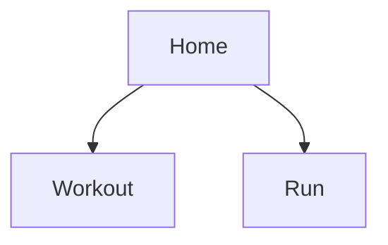
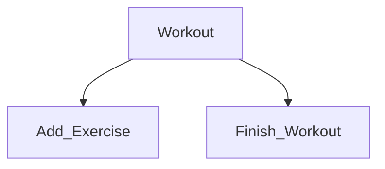
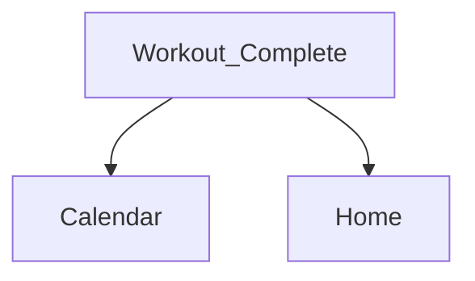
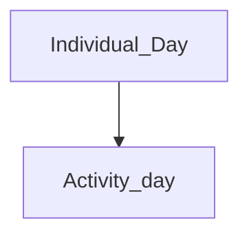
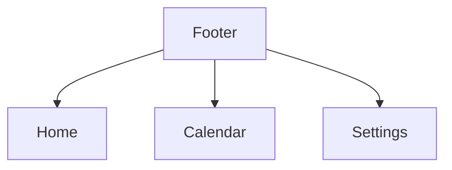

# StrideSet – Technical Document - Stage II

## Development Lead responsibilities during Stage II

Reviews design feasibility, identifies technical constraints, plans screen and navigation implementation, defines required data and system states, and prepares the team for development.

## 1. Technical Constraints

| Category | Constraints |
| ------------------ | ------------------ |
| Platform | Android only |
| UI Kit | Material Design v3 |
| Android UI Technology | Jetpack Compose |
| Minimum SDK | API 26.0 - Android 8.0 |
| Targeted SDK | API 37.0 - Android 17.0 |
| Storing Workout / Run Data | Local Data Persistence |

## 2. Design Feasability

The analysis regarding the design was done with the help of the interactive prototype and is focused primarily
technical feasibility.

| Screen | Feasibility / Risk | Reasoning | Recommendation(s) |
| ------------------ | ------------------ | ------------------ | ------------------ |
| Home 'Start' Screen | High&nbsp;Feasibility&nbsp;/&nbsp;Low&nbsp;Risk | Acts mainly as a navigation screen | Utilize a built in controller for navigation, that can be used to define routes for different screens |
| Workout | High&nbsp;Feasibility&nbsp;/&nbsp;Medium&nbsp;Risk | Rows displays different data with variations applying to each individual exercise | Build each exercise row as one resusable component |
| Run | High&nbsp;Feasibility&nbsp;/&nbsp;High&nbsp;Risk | Live tracking requires location permissions. An external API will most likely be needed. Battery drain needs to taken into account, longer distances with accurate route and speed tracking will cause faster battery drain, especially on weaker or older devices | Fall back to manual entry if tracking implementation isn't feasible in the long run |
| Calendar | High&nbsp;Feasibility&nbsp;/&nbsp;Low&nbsp;Risk | Needs to be stored additionally along with workout information | Adding an extra field to the workout entity, which saves the date of the workout as a timestamp |
| Settings | High&nbsp;Feasibility&nbsp;/&nbsp;Low&nbsp;Risk | Settings are mainly for changing the weight (km or mi) and distance(kg or lb) conversions, so mainly just boolean triggers. | Add an extra table for storing the settings |

## 3. Screen and Navigation Implementation

### 3.1 Navigation Graphs

Home 'Start' Screen:

&nbsp;&nbsp;

---

Workout Screen:

&nbsp;&nbsp;

---

Workout Complete Screen:

&nbsp;&nbsp;

---

Calendar Screen:

&nbsp;&nbsp;

---

Footer or The Bottom Menu:

&nbsp;&nbsp;

## 4. Definining Data and System States

---

### 4.1 Home

| State | Trigger | Behaviour |
| --- | --- | --- |
| Default | No unfinished workout or run exists | Title, "Start Workout" and "Start Button", Bottom Footer for Navigation are all displayed |
| Activity in progress | App reopened while a workout or run is in progress | Either bring the user back to the workout or run screen directly or replace the Start Workout / Run button with a temporary "Resume" button |
| Error | N/A, possible causes need to be determined during development | Home displays no Data or an error message is shown |

---

### 4.2 Workout

| State | Trigger | Behaviour |
| --- | --- | --- |
| Leave attempt | Back pressed on Android while in Workout mode | Dialog Window popup: Finish Workout / Discard / Continue (To clear the popup, possibly a missclick by the user) |
| Discard Workout Confirmation | Discard button pressed | A confirmation dialogue window pops up. Workout should be discarded / deleted after confirmation |
| Validation failure: empty workout | Finish Workout button pressed with no exercises or completed sets | Finish Workout button blocked along with a proper message |
| Validation failure: missing info regarding the exercise | A weight is assigned but no reps are written down | Display a proper warning |
| Default | One or more plans saved | Start empty workout button, Create Plan button, a list of saved plans along with an edit button are all displayed |
| Loading | Fetching plans from the database | Local data loads pretty much instantly |
| Error | Fetching the plans fails | Display an error for the plans specifically, but keep the Start Empty Workot usable |
| Navigate Back | Button pressed or the Android global back button is pressed | Return to Home screen |

#### Validation rules

| Field | Rule(s) | Error message | When checked (typing / leaving field / saving) |
| --- | --- | --- | --- |
| Sets | No negative numbers or 0, no impossibly large numbers like 9999 | "Please enter a valid number of sets" | Leaving the field |
| Weight | No negative numbers or again very large numbers. 0 here is fine since maybe the excercise is done with just the base weight, for example just the bar or using bodyweight | "Please enter a valid weight" | Leaving the field |

---

### 4.3 Run

| State | Trigger | Behaviour |
| --- | --- | --- |
| Permission needed | "Start run" pressed and location permission not granted | _(Potential handling)_ Explanation of why location is needed, then the system permission dialog |
| Permission denied | User denies location permission | _(Potential handling)_ Message that displays for example "cannot be tracked without location", with a guide perhaps on how to enable set permission |
| Searching for GPS | Permission granted, no GPS found yet | _(Potential handling)_ "Searching for GPS" shown |
| Tracking | GPS working through an external API | Elapsed time, distance and pace update live. Pause, End Run, Discard are displayed properly |
| Paused | Pause button pressed | _(Potential handling)_ Timer and distance frozen, Pause becomes "Resume" |
| Signal lost | No GPS updates for a set time while tracking | _(Potential handling)_ Timer continues, distance stops updating, "GPS signal lost" indicator is displayed |
| Leave attempt | Android System Back pressed | _(Potential handling)_ End run / Discard / Continue run button displayed on a pop up window, also clicking outside the window can close the popup, timer and distance are still tracking |
| Discard confirmation | Discard button pressed | Confirmation dialog; the run is deleted only after confirming |
| In background | Screen off or user leaves the app during tracking | _(Potential handling)_ Tracking continues. Persistent notification shows the run and returns to this screen when pressed |
| Success | End run button pressed | Run saved, Run complete screen gets displayed |
| Error | Saving fails | _(Potential handling)_ Message shown, run data is kept |

---

### 4.4 Calendar

| State | Trigger | Behaviour |
| --- | --- | --- |
| Default | Calendar tab opened | Current month, today selected, dots on days with activities, list of the selected day's activities |
| Day with activities | Day with saved activities selected | List of workouts and runs with summary (duration, exercises or distance) and › to details |
| Day without activities | Day with no saved activities selected | _(Potential handling)_ "No activities were performed on this day" |
| Empty | No activities saved at all | _(Potential handling)_ Calendar is shown without any dots |
| Month change | Arrow buttons pressed on the top right | Months cycle in correct order |
| Loading | Reading activities | Not shown since local data should load instantly |
| Error | Reading activities fails | _(Potential handling)_ A message displaying loading or fetching |

---

### 4.5 Settings

| State | Trigger | Behaviour |
| --- | --- | --- |
| Default | Settings tab was opened or selected in the footer | User preferences for units are selected and assigned |
| Unit changed | User selects another unit | _(Potential handling)_ Saved immediately; the new unit is used for workouts and runs |
| Error | Saving the preference fails | _(Potential handling)_ Selection reverts, a pop up comes up |
| Empty / Loading | N/A, possible causes need to be determined during development | Not shown: Default conversion are shown |

---

### 4.6 App-wide states

| State | Trigger | Behaviour |
| --- | --- | --- |
| First launch | No data saved | _(Potential handling)_ Home in default state; Choose workout and Calendar show their empty states; units default to km and kg |
| App closed mid-workout | App process ends while a workout is unfinished | _(Potential handling)_ Workout is kept in memory or in some sort of cache. After reopening the app, the workout can be resumed |
| App closed mid-run | App removed from recent apps or killed during a run | _(Potential handling)_ Tracking continues or the run is saved and and the app triggers an end |

## 5. Preparation for Development

- A repository has been made with the empty activity template utilizing the JetPack Compose workflow.
- Proper package naming completed.
- Min and targeted SDK's have been assigned in the project settings accordingly.
- Version control is in place along with a proper gitignore file.
